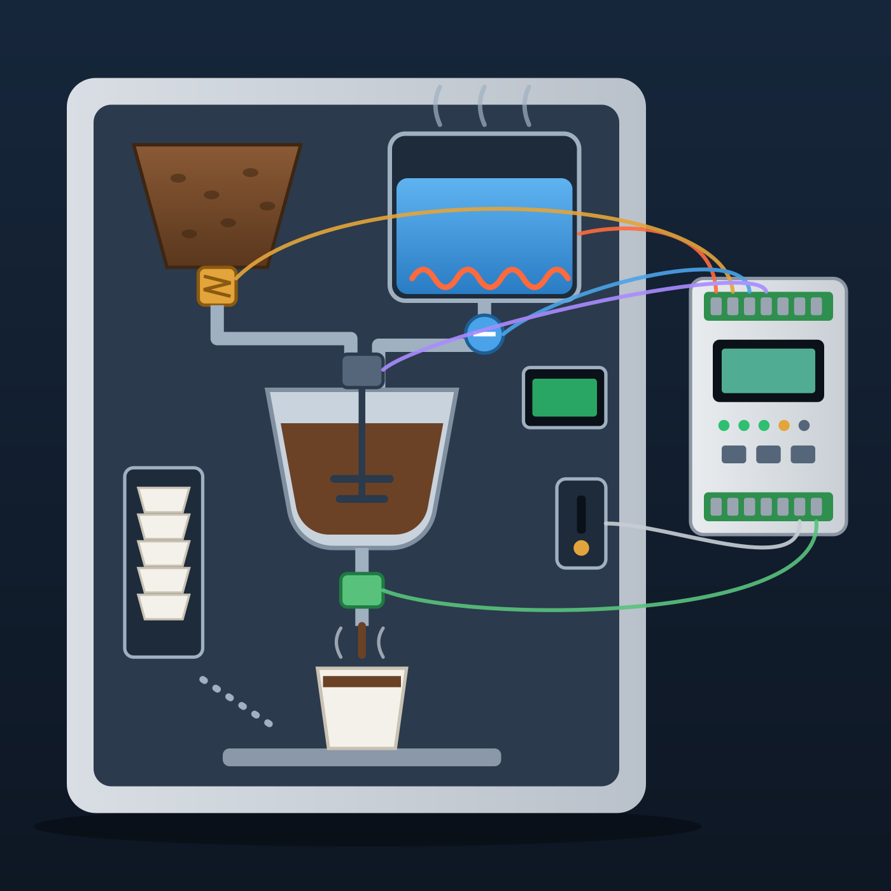
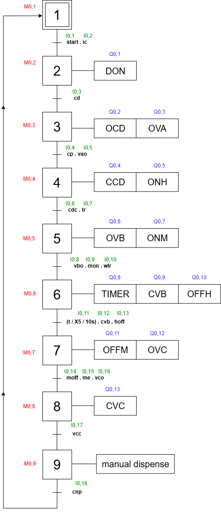
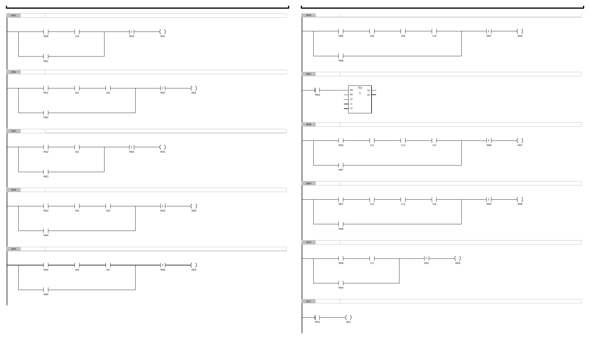
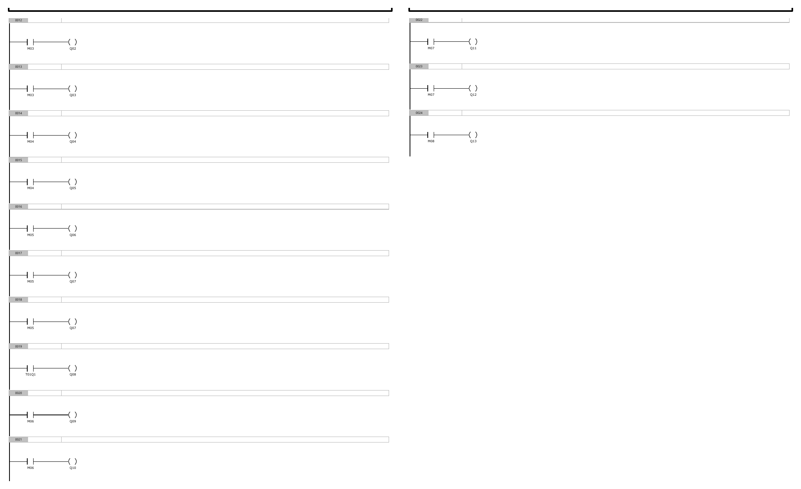

# PLC Coffee Vending Machine

A PLC program that runs a coffee vending machine from start to served cup, designed as a sequential function chart (SFC) and implemented in ladder logic for an Eaton easyE4 controller.

**Built:** January 2025 · Industrial control course project
**Status:** verified in the easySoft simulator; not deployed on physical hardware.

## Results

| Metric | Result |
| --- | --- |
| Sequence | 9 steps, 17 transition signals, 12 actions |
| Program | 24 ladder rungs: 18 inputs, 13 outputs, 9 step markers, 1 on-delay timer |
| Verification | Full cycle run in the easySoft simulator, from start to cup removed and back to idle |

## How it works

| Step | What the machine does | Moves on when |
| --- | --- | --- |
| 1 | Idle | Start switch pressed and initial conditions OK (I0.1, I0.2) |
| 2 | Display on (Q0.1) | Cup dispensed (I0.3) |
| 3 | Open the cup dispenser (Q0.2); fire the coffee dose through spring-loaded valve A (Q0.3) | Cup present, valve A opened (I0.4, I0.5) |
| 4 | Close the cup dispenser (Q0.4); heater on (Q0.5) | Dispenser closed, water at 90–96 °C (I0.6, I0.7) |
| 5 | Open water valve B (Q0.6); mixer on (Q0.7) | Valve B open, mixer running, water level reached (I0.8 to I0.10) |
| 6 | Start the 10 s mixing timer (Q0.8); close valve B (Q0.9); heater off (Q0.10) | 10 s elapsed, valve B closed, heater off (I0.11 to I0.13) |
| 7 | Mixer off (Q0.11); open valve C to pour into the cup (Q0.12) | Mixer off, mixer empty, valve C open (I0.14 to I0.16) |
| 8 | Close valve C (Q0.13) | Valve C closed (I0.17) |
| 9 | Customer takes the cup | Cup removed (I0.18), then back to step 1 |

Valve A is spring-loaded: one pulse shoots a pre-set dose of coffee powder and the spring closes it, so no separate close action is needed.

## Hardware and software

| Item | Notes |
| --- | --- |
| Controller | Eaton (Moeller) easyE4 |
| Programming | easySoft-Pro 8.25, ladder diagram |
| Design | SFC drawn in draw.io |

## Engineering notes

Each SFC step became a marker (M01 to M09). A step's rung sets its marker when the previous step is active **and** its transition inputs are true. A holding contact keeps it on, and the next step's marker switches it off. This keeps exactly one step active at a time. The output rungs then drive each output (Q01 to Q13) from its step marker, and timer T02 (on-delay) handles the 10-second mixing time.

## Repository layout

| File | Purpose |
| --- | --- |
| `program/coffee_vending_machine.e80` | easySoft project: the full ladder program |
| `program/ladder_program_printout.pdf` | Printout of all 24 rungs, timer settings and cross-reference list |
| `program/sfc_diagram.drawio` | Editable SFC |
| `media/` | Images used in this README |

## Open it

1. Install easySoft (version 8 or later) from Eaton's website.
2. Open `program/coffee_vending_machine.e80`.
3. Switch to simulation mode and toggle the inputs (I01 to I18) in step order to run the cycle.

No software? `program/ladder_program_printout.pdf` shows the whole program, and `program/sfc_diagram.drawio` opens at [app.diagrams.net](https://app.diagrams.net).

## Limitations and next steps

- Simulation only: the program has not run on a physical easyE4 with real sensors and valves.
- No emergency stop or fault states yet (for example, a timeout if the water never reaches temperature). These are the first additions for real hardware.
- One drink type; adding sugar or size options would mean branching the SFC.
- Coin validation is represented by the start signal rather than a separate coin-counting stage.

## Author

**Michel Salame** — [LinkedIn](https://www.linkedin.com/in/michel-salame)
